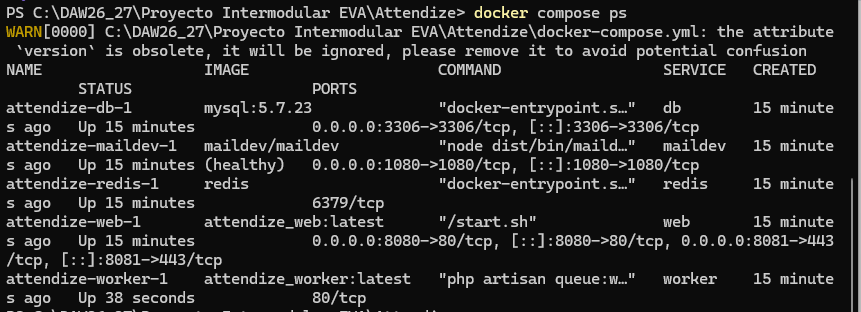
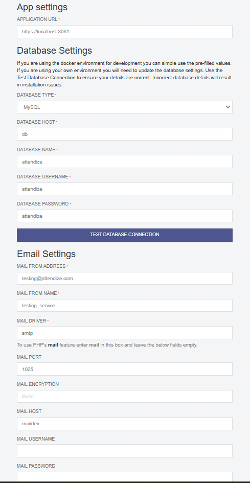
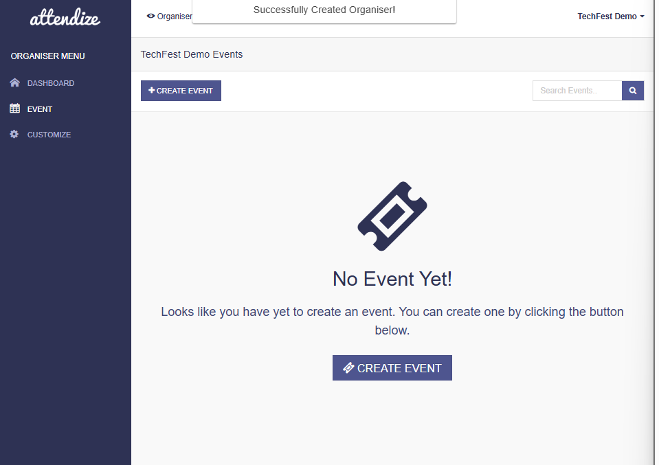
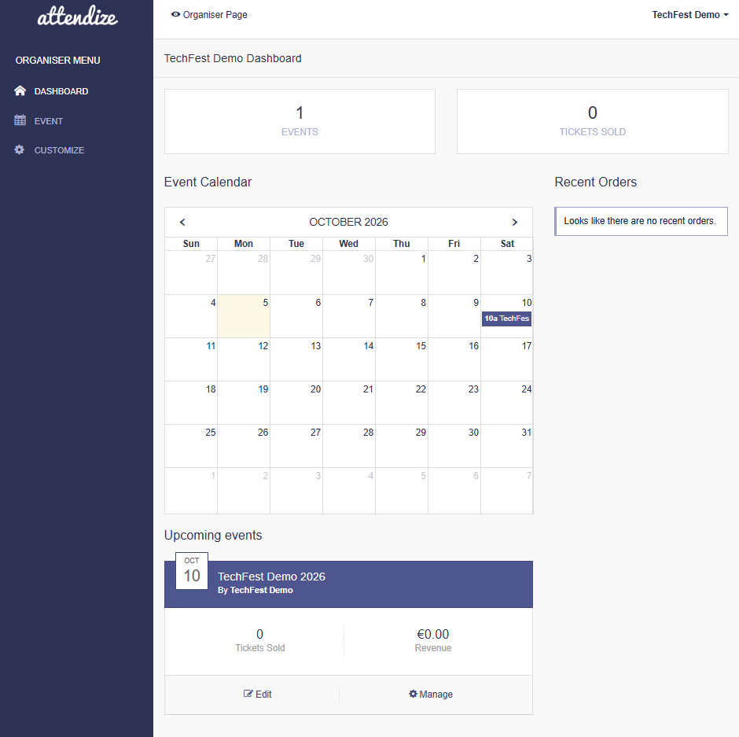

# Attendize v2.8.0 · Tarea 01

## Puesta en marcha de Attendize con Docker y MySQL

Este repositorio es un **fork de Attendize**, una aplicación web para gestionar eventos y entradas.

En esta tarea se parte de **Attendize v2.8.0** y se prepara un entorno local con Docker y MySQL. No se modifica todavía el funcionamiento de la aplicación; el objetivo es conseguir que pueda ejecutarse correctamente y documentar el proceso.

- **Repositorio oficial:** https://github.com/Attendize/Attendize
- **Versión de partida:** `v2.8.0`
- **Commit de partida:** `47997d2`
- **Mi fork:** https://github.com/OniriaInfinita/Attendize
- **Rama de trabajo:** `tarea-01-despliegue`
- **Etiqueta inicial:** `tarea-01-inicio`
- **Etiqueta final:** `tarea-01-entrega`


## 1. Requisitos previos

El trabajo se ha realizado en Windows utilizando PowerShell.

Versiones utilizadas:

- Git: `2.47.0.windows.1`
- Docker Engine: `29.8.0`
- Docker Desktop: `4.91.0`
- Docker Compose: `v5.5.1`

Antes de comenzar, Docker Desktop debe estar iniciado.

Para comprobarlo:

```powershell
docker version
docker compose version
```


## 2. Obtener el proyecto

Clonar mi fork:

```powershell
git clone https://github.com/OniriaInfinita/Attendize.git
cd Attendize
```

Para utilizar exactamente la versión final entregada:

```powershell
git checkout tarea-01-entrega
```


## 3. Servicios Docker

El entorno utiliza cinco servicios:

| Servicio | Para qué sirve | Puerto |
|---|---|---|
| `web` | Ejecuta Attendize y permite acceder desde el navegador | `8080` y `8081` |
| `db` | Base de datos MySQL | `3306` |
| `maildev` | Correo de pruebas | `1080 / 1025` |
| `worker` | Ejecuta tareas de Laravel en segundo plano | interno |
| `redis` | Servicio auxiliar utilizado por Attendize | interno |

Todos los servicios se comunican mediante la **red interna creada por Docker Compose**.

MySQL utiliza un **volumen de datos**. Esto permite conservar la información aunque los contenedores se detengan y vuelvan a iniciarse.

Archivos Docker utilizados:

- [Dockerfile](Dockerfile)
- [docker-compose.yml](docker-compose.yml)
- [Makefile](Makefile)

### Esquema sencillo

```text
Navegador
    |
    v
   web
    |
    +----> MySQL (db) ----> datos persistentes
    |
    +----> Redis
    |
    +----> MailDev

worker
  |
  +----> trabaja en segundo plano con la aplicación
```


## 4. Configuración

Se crea `.env` a partir de `.env.example`.

En PowerShell:

```powershell
Copy-Item .env.example .env
```

Las variables principales utilizadas son:

```text
APP_URL=https://localhost:8081

DB_CONNECTION=mysql
DB_HOST=db
DB_PORT=3306
DB_DATABASE=attendize
DB_USERNAME=attendize
DB_PASSWORD=attendize

MAIL_HOST=maildev
MAIL_PORT=1025
```

`DB_HOST=db` indica que Attendize debe conectarse al servicio `db` de Docker Compose.

`MAIL_HOST=maildev` indica que se utiliza el servidor de correo de pruebas.

El archivo `.env` **no se sube a GitHub**.

`APP_KEY` tampoco se publica, ya que es una clave de la aplicación.


## 5. Construcción de las imágenes

Las imágenes Docker se construyen en este orden:

```powershell
docker build --tag attendize_base --target base .
```

```powershell
docker build --tag attendize_worker --target worker --cache-from attendize_base:latest .
```

```powershell
docker build --tag attendize_web --target web --cache-from attendize_worker:latest .
```

Las tres imágenes terminaron construyéndose correctamente:

```text
attendize_base:latest
attendize_worker:latest
attendize_web:latest
```


## 6. Iniciar y comprobar los servicios

Para iniciar el entorno:

```powershell
docker compose up -d
```

Para comprobar los servicios:

```powershell
docker compose ps
```

En la comprobación final, los cinco servicios (db, maildev, redis, web y worker) permanecen activos.

<p align="center">
  
</p>

<p align="center">
  <em>Figura 1. Los servicios db, maildev, redis, web y worker permanecen activos.</em>
</p>

**Fecha:** 25/10/2026  
**Commit:** `ab3384c`

## 7. Preparar Laravel y MySQL

Una vez iniciados los servicios se ejecutó el comando indicado en la tarea:

```powershell
docker compose exec web sh -c "wait-for-it db:3306 -t 180 && php artisan key:generate && php artisan migrate"
```

Este comando:

1. espera a que MySQL esté disponible;
2. genera `APP_KEY`;
3. ejecuta las migraciones de la base de datos.

Después fue necesario recrear `web` y `worker` para que cargaran el nuevo valor de `APP_KEY`:

```powershell
docker compose up -d --force-recreate web worker
```


## 8. Instalación de Attendize

El instalador se abre en:

https://localhost:8081/install

Durante la instalación se utilizaron los datos del entorno Docker local:

```text
Application URL: https://localhost:8081

Database:
Host: db
Name: attendize
Username: attendize

Correo:
Host: maildev
Port: 1025
```

<p align="center">
  
</p>

<p align="center">
  <em>Figura 2. Configuración de la aplicación, base de datos y correo durante la instalación de Attendize.</em>
</p>

**Fecha:** 25/10/2026  
**Commit:** `ab3384c`

La conexión con la base de datos se comprobó correctamente mediante **TEST DATABASE CONNECTION**.

No se configuraron pagos reales ni servicios externos.

Después de completar la instalación, Attendize se puede abrir en:

https://localhost:8081/


## 9. Datos ficticios de prueba

Para comprobar el funcionamiento se utilizaron datos ficticios.

### Usuario

```text
Correo: organizador@techfest.local
```

La contraseña no se publica en GitHub.

### Organizador

```text
TechFest Demo
```
<p align="center">
  
</p>

<p align="center">
  <em>Figura 3. Organizador ficticio TechFest Demo creado correctamente.</em>
</p>

**Fecha:** 25/10/2026  
**Commit:** `ab3384c`

### Evento

```text
TechFest Demo 2026
Fecha: 10/10/2026
Horario: 10:00 - 18:00
Lugar: Centro TechFest Demo
Ciudad: Valencia
```


## 10. Comprobación de persistencia

Con el evento ya creado se detuvieron los servicios:

```powershell
docker compose stop
```

Después se volvieron a iniciar:

```powershell
docker compose start
```

Y se comprobó su estado:

```powershell
docker compose ps
```

Al volver a acceder a Attendize, el evento **TechFest Demo 2026 seguía disponible**.

<p align="center">
  
</p>

<p align="center">
  <em>Figura 4. TechFest Demo 2026 continúa disponible después de detener e iniciar los servicios.</em>
</p>

**Fecha:** 25/10/2026  
**Commit:** `ab3384c`

Por tanto, se comprobó que los datos de MySQL se conservan después de detener y volver a iniciar los contenedores.


## 11. Problemas encontrados y soluciones

### Issue 1 · Repositorios Debian Buster

La construcción de `attendize_base` fallaba durante:

```text
apt-get update
```

La causa era que Attendize v2.8.0 utiliza una imagen antigua basada en Debian Buster.

**Solución:** se modificó el `Dockerfile` para utilizar snapshots históricos de Debian Buster sin cambiar la versión de Attendize.

[Ver Issue #1](https://github.com/OniriaInfinita/Attendize/issues/1)

---

### Issue 2 · `scripts/setup` y CRLF

La construcción avanzó después hasta:

```text
./scripts/setup: not found
```

El archivo existía, pero Windows lo había guardado con finales de línea `CRLF`, mientras que el contenedor Linux necesitaba `LF`.

**Solución:** se cambió `scripts/setup` a formato `LF`.

Además se añadió a `.gitattributes`:

```text
scripts/setup text eol=lf
```

para evitar que vuelva a convertirse a `CRLF`.

[Ver Issue #2](https://github.com/OniriaInfinita/Attendize/issues/2)

---

### Issue 3 · Worker detenido

Después de iniciar Docker Compose, el `worker` se detenía porque no encontraba:

```text
vendor/autoload.php
```

La carpeta local todavía no contenía las dependencias de Composer.

**Solución:** se instalaron mediante:

```powershell
docker compose exec web composer install --no-interaction --no-scripts
```

y después se inició nuevamente el worker:

```powershell
docker compose start worker
```

Finalmente los cinco servicios quedaron activos.

[Ver Issue #3](https://github.com/OniriaInfinita/Attendize/issues/3)

---

### APP_KEY no cargada

Durante la instalación, Attendize indicó que faltaba `APP_KEY` aunque ya se había generado.

La causa era que los contenedores `web` y `worker` se habían creado antes de generar la nueva clave.

**Solución:**

```powershell
docker compose up -d --force-recreate web worker
```

Después de recrearlos, Attendize pudo continuar con la instalación.


### Limitaciones pendientes

No se han identificado limitaciones pendientes que impidan el funcionamiento del entorno local requerido para esta tarea.

## 12. Resultado final

Se ha comprobado que:

- Attendize funciona mediante Docker.
- Los cinco servicios necesarios permanecen activos.
- Attendize se conecta correctamente a MySQL.
- Se puede iniciar sesión.
- Se puede crear un organizador y un evento ficticio.
- El evento continúa disponible después de detener y volver a iniciar los servicios.
- `.env` y las claves de la aplicación no se publican en GitHub.
- Los problemas encontrados han sido documentados y solucionados.